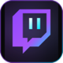

# ⚡ Twitch Neo for LG webOS TV

<p align="center">
  
</p>

<p align="center">
  <strong>Next-Generation Native Twitch Client for LG webOS Smart TVs</strong><br>
  1440p60 Hardware Playback • Built-in ReYohoho Ad-Free • 10-Foot TV UI • Magic Remote Ready
</p>

<p align="center">
  <a href="LICENSE"></a>
  
  
  
</p>

---

## 📖 О проекте

**Twitch Neo** — независимый, ультралегкий нативный клиент Twitch для телевизоров LG webOS. В отличие от официального веб-приложения и старых веб-оберток (расходовавших до 400 МБ ОЗУ на тяжелый React-бандл и вызывавших вылеты и заикания), **Twitch Neo** написан на чистом нативном JavaScript и Hls.js с аппаратным ускорением видеоядра webOS.

Весь пакет весит всего **211 КБ**, запускается за **< 250 мс** и оставляет 100% аппаратных ресурсов телевизора исключительно под декодирование видео в **1440p60** и **1080p60**.

---

## 🚀 Ключевые возможности

- 🎬 **Аппаратный декодер 1440p60 / 1080p60:**
  Динамический патчер манифестов (`src/player/codecs.js`) на лету приводит нестандартные строки Twitch HEVC к спецификации `hvc1.1.6.L150.B0` (HEVC Level 5.0 Main Tier) и ограничивает уровни AVC до `avc1.64002a`, открывая плавные 60 FPS без задержек и перегрузки видеоядра.
- 🛡 **Встроенный обход рекламы ReYohoho:**
  Прямая интеграция с быстрыми серверами ReYohoho (`proxy4.rte.net.ru`, `proxy7`, `proxy5`, `proxy6`) с автоматическим переключением при сбоях. Видеопоток идет напрямую с CDN Twitch на полной скорости.
- 📺 **Настоящий 10-футовый интерфейс (10-Foot TV UI):**
  Интерфейс спроектирован специально для больших экранов ТВ (просмотр с дивана с расстояния 2.5–4 метра):
  - 3 широкие колонки стримов с крупными карточками 16:9.
  - Большой Hero-баннер главного стрима (440px) с высоким разрешением.
  - Крупные читаемые шрифты (19–34px), большие аватары стримеров (54px) и яркие бейджи.
  - Просторная сетка категорий (5 колонок) с четкими обложками игр 3:4.
- 🎮 **Полная поддержка пультов LG Magic Remote и ИК-пультов:**
  Геометрическая система 2D Spatial Navigation мгновенно перемещает фокус стрелками D-pad, реагирует на кнопку **Back** (код `461`), колесико/Enter и медиа-клавиши.
- 🔑 **Вход через официальный TV Device Code (`twitch.tv/activate`):**
  Никакого мучительного ввода логина и пароля экранной клавиатурой. При входе на экране ТВ появляется крупный код активации: введите его со смартфона на `twitch.tv/activate`, и ТВ автоматически подключит ваш аккаунт и раздел «Отслеживаемые».
- 📊 **Инфо для гиков (Stats for Nerds):**
  Встроенный оверлей в реальном времени отображает точное разрешение, FPS, битрейт потока, видеокодек, размер буфера в секундах, пропущенные кадры и активную ноду прокси.

---

## 🎮 Управление с пульта

| Кнопка | Действие |
| :--- | :--- |
| **Стрелки (D-pad)** | Навигация между карточками стримов, разделами и кнопками плеера |
| **Колесико / OK (Enter)** | Выбор / запуск стрима / нажатие кнопки |
| **Back (Назад / 461)** | Закрыть плеер • Закрыть диалог качества • Возврат к категориям или на Главную |
| **Play / Pause** | Пауза и продолжение воспроизведения потока |
| **Кнопка «Качество»** | Выбор разрешения (Авто, 1440p60, 1080p60, 720p60 и др.) |
| **Кнопка «Инфо»** | Включение / выключение оверлея «Stats for Nerds» |

---

## 📦 Установка

### Способ 1: Через webOS Dev Manager (Рекомендуемый)
1. Скачайте свежий файл `tv.twitch.neo_1.0.0_all.ipk` из [Релизов](https://github.com/Bernathhh/twitch-neo/releases).
2. Откройте **webOS Dev Manager** на вашем компьютере.
3. Нажмите кнопку **«Install»** вверху экрана и выберите скачанный `.ipk` файл.

### Способ 2: Через Homebrew Channel
1. Скопируйте файл `.ipk` на флешку или загрузите на ТВ через Homebrew Channel.
2. Подтвердите установку в меню Homebrew.

### Способ 3: Через терминал / CLI
```bash
ares-install -d <имя_устройства> tv.twitch.neo_1.0.0_all.ipk
```

---

## 🛠 Сборка из исходного кода

```bash
# Клонирование репозитория
git clone https://github.com/Bernathhh/twitch-neo.git
cd twitch-neo

# Установка зависимостей
npm install

# Сборка продакшн-бандла Webpack
npm run build

# Создание пакета IPK для webOS
npm run package

# Генерация манифеста
npm run manifest

# Полный цикл релиза (сборка + упаковка + манифест)
npm run release
```

---

## 📄 Лицензия

Проект распространяется под свободной лицензией **GNU General Public License v3.0**. Подробнее см. в файле [LICENSE](LICENSE).

Автор: **Bernath** ([@Bernathhh](https://github.com/Bernathhh))
